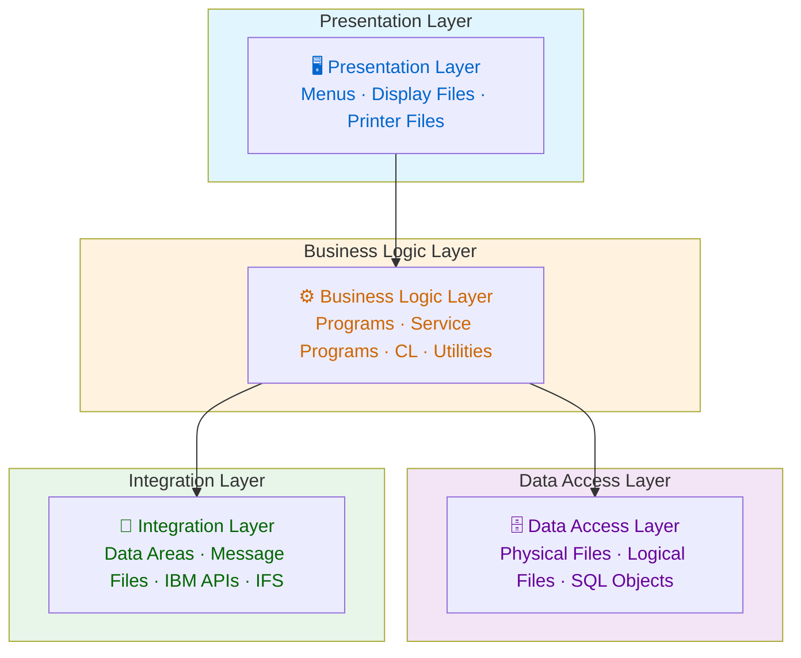
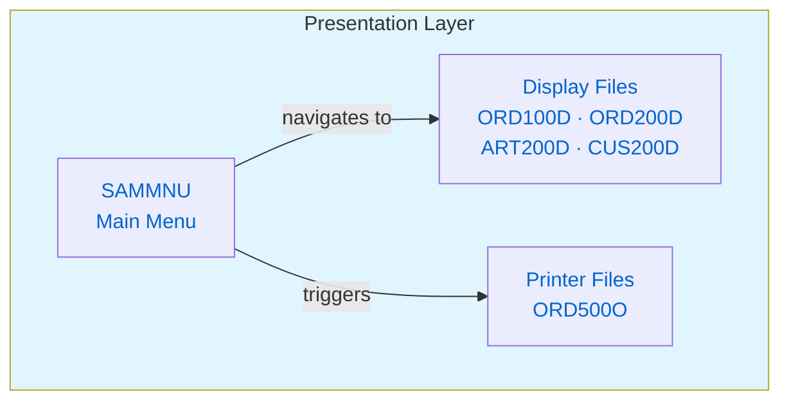
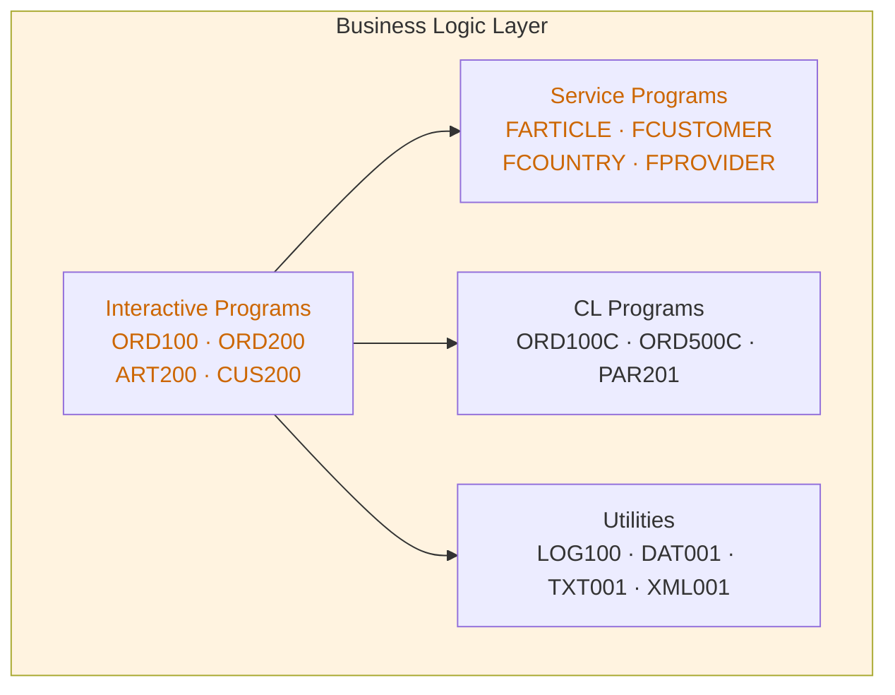
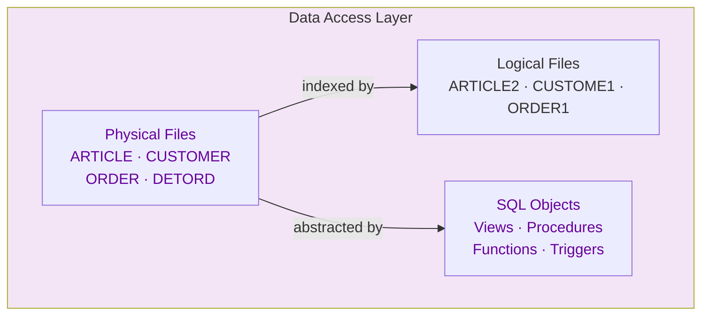
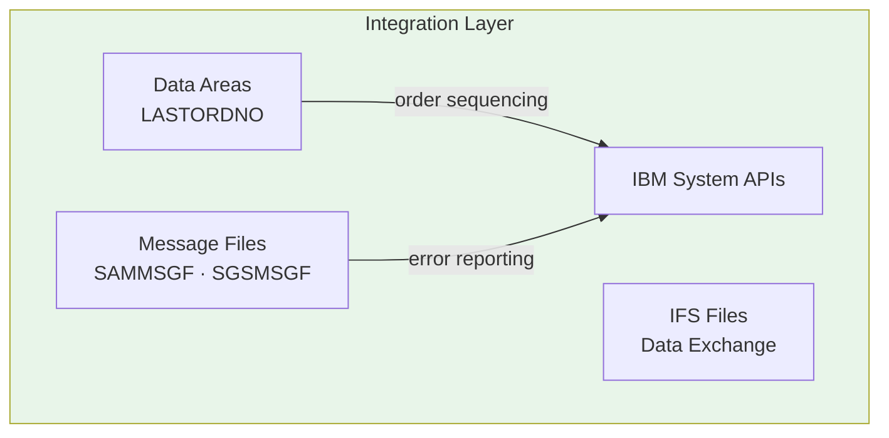
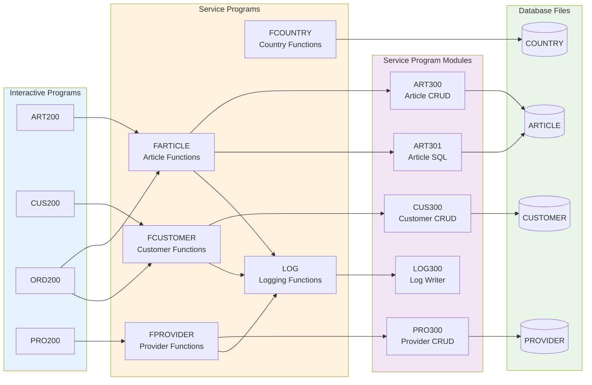

# SAMCO Interactive Architecture Diagrams

> **How to navigate:** Click any highlighted node to jump to the detailed diagram for that layer.
> Each detail diagram has a **⬆ Back to Overview** link to return here.

---

## Overview



> 💡 **Tip:** In GitHub-rendered Markdown, clicking a highlighted node jumps directly to that section below.

---

## Presentation Layer Detail

[⬆ Back to Overview](#overview)



---

## Business Logic Layer Detail

[⬆ Back to Overview](#overview)



---

## Data Access Layer Detail

[⬆ Back to Overview](#overview)



---

## Integration Layer Detail

[⬆ Back to Overview](#overview)



---

## Entity Relationship Diagram

[⬆ Back to Overview](#overview) | [⬆ Data Access Layer](#data-access-layer-detail)

```mermaid
erDiagram
    CUSTOMER ||--o{ ORDER : places
    ORDER ||--|{ DETORD : contains
    DETORD }o--|| ARTICLE : references
    ARTICLE }o--|| FAMILLY : belongs_to
    ARTICLE }o--o{ ARTIPROV : has
    ARTIPROV }o--|| PROVIDER : links
    CUSTOMER }o--|| COUNTRY : located_in

    CUSTOMER { decimal CUSNUM PK; string CUSNAM; string CUSCOU FK }
    ORDER     { decimal ORDNUM PK; decimal ORDCUS FK; string ORDSTA }
    DETORD    { decimal DETORD PK_FK; string DETART FK; decimal DETQTY }
    ARTICLE   { string ARTNUM PK; decimal ARTPRI; string ARTFAM FK }
    FAMILLY   { string FAMCOD PK; decimal FAMVAT }
```

---

## Order Creation Workflow

[⬆ Back to Overview](#overview) | [⬆ Business Logic Layer](#business-logic-layer-detail)

```mermaid
flowchart TD
    Start([User Selects Order Entry]) --> Menu[SAMMNU Menu]
    Menu --> ORD100[ORD100: Order List]
    ORD100 --> Choice{Create New\nor Maintain?}

    Choice -->|Create New| ORD101[ORD101: Order Header Entry]
    Choice -->|Maintain|   ORD200[ORD200: Order Maintenance]

    ORD101 --> ValidCust{Validate Customer}
    ValidCust -->|Invalid| CustError[Display Error] --> ORD101
    ValidCust -->|Valid|   GenOrdNum[Generate Order Number]

    GenOrdNum --> CreateHeader[Create ORDER Record]
    CreateHeader --> ORD202[ORD202: Order Line Entry]

    ORD202 --> ValidArt{Validate Article}
    ValidArt -->|Invalid| ArtError[Display Error] --> ORD202
    ValidArt -->|Valid|   CheckQty{Check Quantity}

    CheckQty -->|Insufficient| QtyError[Display Warning] --> ORD202
    CheckQty -->|Sufficient|   CalcLine[Calculate Line Amount]

    CalcLine --> CalcVAT[Calculate VAT] --> AddLine[Add DETORD Record]
    AddLine --> MoreLines{Add More Lines?}
    MoreLines -->|Yes| ORD202
    MoreLines -->|No|  CalcTotal[Calculate Order Total]

    CalcTotal --> UpdateHeader[Update ORDER with Totals]
    UpdateHeader --> Commit{Commit Transaction?}
    Commit -->|Yes| CommitTrans[Commit Changes]
    Commit -->|No|  Rollback[Rollback Changes]

    CommitTrans --> Print{Print Confirmation?}
    Print -->|Yes| ORD500[ORD500: Print Order] --> End([End])
    Print -->|No|  End
    Rollback --> End

    ORD200 --> ORD201[ORD201: Header Maintenance] --> ORD202

    style Start fill:#4caf50
    style End fill:#f44336
    style ValidCust fill:#ff9800
    style ValidArt fill:#ff9800
    style CheckQty fill:#ff9800
    style Commit fill:#2196f3
```

---

## Service Program Architecture

[⬆ Back to Overview](#overview) | [⬆ Business Logic Layer](#business-logic-layer-detail)


