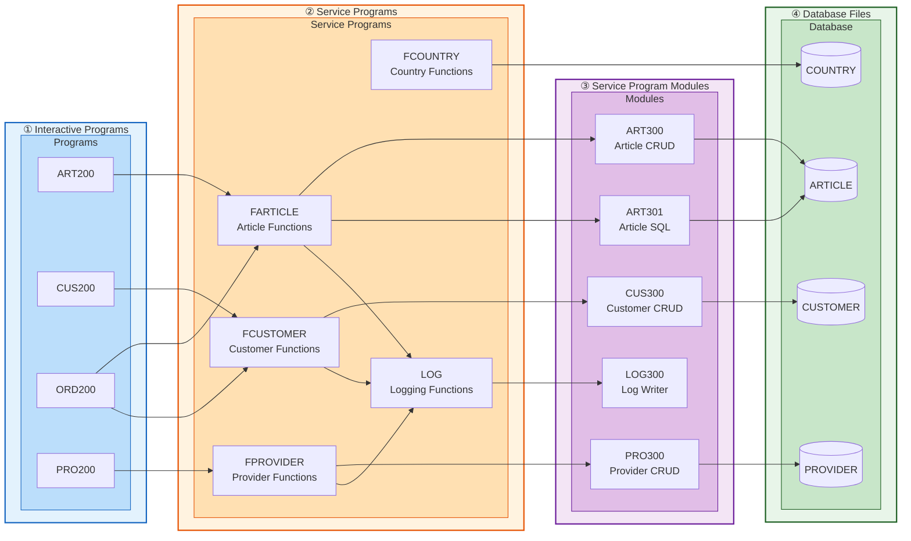

# SAMCO Service Program Architecture

> Nested subgraph view of the four layers: Interactive Programs → Service Programs → Modules → Database Files.

---

| Tier | Contents | Responsibility |
|------|----------|----------------|
| **① Interactive Programs** | ART200, CUS200, ORD200, PRO200 | Screen-driven entry points called from menus |
| **② Service Programs** | FARTICLE, FCUSTOMER, FCOUNTRY, FPROVIDER, LOG | Shared business-logic facades bound to programs at activation |
| **③ Service Program Modules** | ART300, ART301, CUS300, PRO300, LOG300 | Compiled modules packaged into each service program |
| **④ Database Files** | ARTICLE, CUSTOMER, PROVIDER, COUNTRY | Physical files accessed by the modules |
